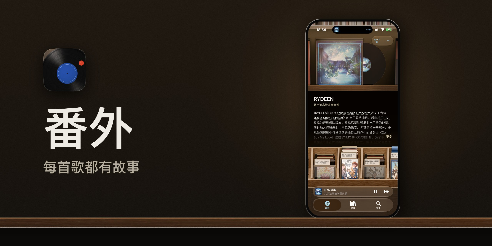

<p align="center">
  
</p>

<p align="center">
  <a href="#install"></a>
  
  
  <a href="CHANGELOG.md"></a>
  <a href="LICENSE"></a>
</p>

<p align="center">
  <a href="README.md">简体中文</a> · <b>English</b> · <a href="https://fanwai.xyz">Website</a> · <a href="CHANGELOG.md">Changelog</a> · <a href="https://fanwai.xyz/privacy">Privacy</a>
</p>

**番外 (Fanwai)** is an iPhone app. Play a song in Apple Music and it looks up where the song comes from: the original it was adapted from, the film, anime or game it belongs to, its covers and samples, and other songs from the same work. Every story comes with its sources, one tap away.

The app is in Simplified Chinese.

## Install

A public TestFlight beta is being prepared. The link will appear here and on [fanwai.xyz](https://fanwai.xyz).

Requires an iPhone with iOS 27.

## How it works

Fanwai first asks public databases (Wikidata, MusicBrainz, Wikipedia) and uses the relations they settle. The rest goes to a language model you connect, which searches the web (DeepSeek's search tool, or the web search built into the OpenAI Responses API). Relations and stories the model writes are checked against the pages it cites; anything that does not match is not shown.

There are no accounts, ads or analytics. Your collection and history stay on the phone, your model key stays in the phone's keychain, and lookups go straight from the phone to the provider you chose. Only lookups made with an invitation code pass through a small relay (`Server/relay`), which records the song and the cost for 90 days. See the [privacy notice](https://fanwai.xyz/privacy) (Chinese).

## Building from source

Requires macOS, Xcode with the iOS 27 SDK, and [XcodeGen](https://github.com/yonaskolb/XcodeGen).

```sh
brew install xcodegen
xcodegen generate     # creates Pianwai.xcodeproj
Tools/test.sh         # builds and runs the unit tests on an iPhone simulator
```

The app ships with no model service or key; enter your own in Settings. To run on a device, set your own team and bundle identifier in Xcode. In this public repository, album covers, film posters and photos of people used by the built-in examples are replaced with grey placeholders, and tests that read internal evaluation material or saved copies of articles from other sites are left out.

## Versions

Each version is one commit with the same code as the TestFlight build of that number, tagged `v<version>-<build>`. Current version: 0.5.36 (56). See the [changelog](CHANGELOG.md).

## Feedback

Use “Send Beta Feedback” in TestFlight, or write to [anson138@126.com](mailto:anson138@126.com). For security issues, see [SECURITY.md](.github/SECURITY.md). Issues and pull requests are not accepted here.

## License

The source is published for reading only. **This is not an open-source project**: all rights are reserved, and you may not copy, modify, distribute it or use it to build or publish any app or service without written permission. See [LICENSE](LICENSE).

---

<sub>© 2026 anson · Apple Music, QQ Music, NetEase Cloud Music, DeepSeek and other names and icons belong to their respective owners.</sub>
