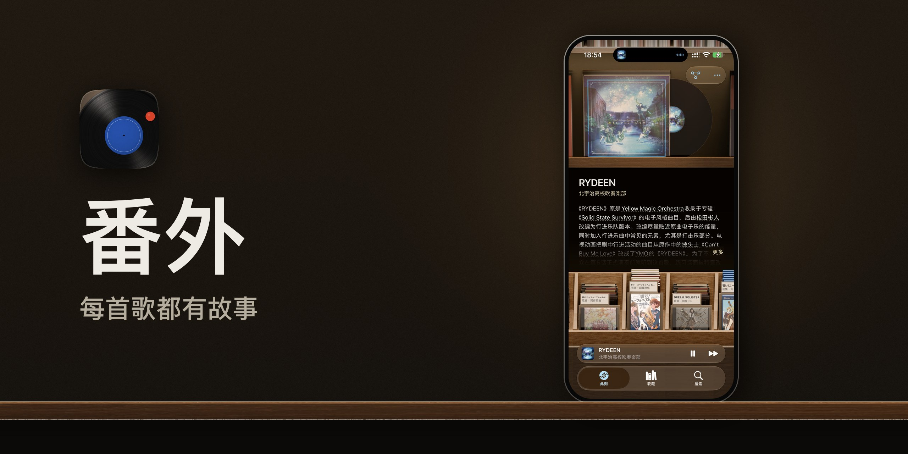

<p align="center">
  
</p>

<p align="center">
  <a href="https://testflight.apple.com/join/TBykrw6v"></a>
  
  
  <a href="CHANGELOG.md"></a>
  <a href="LICENSE"></a>
</p>

<p align="center">
  <b>简体中文</b> · <a href="README.en.md">English</a> · <a href="https://fanwai.xyz">主页</a> · <a href="CHANGELOG.md">更新记录</a> · <a href="https://fanwai.xyz/privacy">隐私说明</a>
</p>

番外是一个 iPhone App。在 Apple Music 放一首歌，它去找这首歌的来历，还有和它有关的电影、动画、游戏、原曲和翻唱。每段故事都带着出处，点开就能看原文。

## 安装

<a href="https://testflight.apple.com/join/TBykrw6v"></a>

1. 在 iPhone 上安装 Apple 的 [TestFlight](https://apps.apple.com/app/testflight/id899247664)。
2. 用 iPhone 打开 <https://testflight.apple.com/join/TBykrw6v>，点「接受」，再点「安装」。

需要 iPhone 和 iOS 27。公开测试当前为 0.5.38（58）；本仓库 App 源码为 0.5.39 (59)，已进入内部测试。

## 一首歌能翻出什么

- **原曲和翻唱**：这首歌改编自哪一首，又被谁翻唱、采样过。
- **出自哪部作品**：它是哪部电影、动画或游戏里的歌；如果是改编版，原声带里对应哪一首。
- **同一部作品的其他歌**：片头曲旁边，放着同一部的片尾曲和插曲。
- **幕后**：谁写的，为什么写，录的时候发生了什么。只收找得到出处的；找不到就空着，不编。

## 开始用

1. **安装番外**，见上面的「安装」。
2. **选你听歌用的 App。** Apple Music 会自动跟着正在播放的歌。QQ 音乐和网易云音乐：在歌曲页点「分享」，复制链接，回到番外粘贴。
3. **接一个大模型。** 番外用它联网查找和写故事，目前用 DeepSeek 最完整。费用由服务商从你自己的账户扣，随模型、搜索次数和资料长度变化；App 内可查看用量和估算费用。App 里有一步步的开通说明。受邀内测的朋友也可以先用体验码。
4. **放一首歌。** 卡片先出来，故事要多等一会儿。

## 它是怎么做的

番外先查 Wikidata、MusicBrainz、维基百科这些公开资料库，能确定的关系直接用；剩下的交给你接的大模型联网搜索（DeepSeek 的搜索工具，或 OpenAI Responses 接口自带的网页搜索）。模型写出的关系和故事，番外会拿它引用的原文核对，对不上的不显示。封面和海报来自 iTunes 公开目录、豆瓣和 Wikimedia。

番外没有账号系统，不放广告，不做统计追踪。收藏和浏览记录默认保存在手机上，模型密钥存在手机的钥匙串里，查找请求用你自己的密钥从手机直接发给你选的服务商，不经过番外的服务器。使用体验码查歌时，请求会经过番外设在香港的中转（`Server/relay`），它记下查了哪首歌、花了多少，保留 90 天。主动提交结果反馈时，也会发送当时页面的歌曲、故事、关联和有限诊断信息，用于排查问题，保留 90 天；不附带密钥、体验码或整份资料库。细节见[隐私说明](https://fanwai.xyz/privacy)。

## 从源码编译

需要 macOS、Xcode（带 iOS 27 SDK）和 [XcodeGen](https://github.com/yonaskolb/XcodeGen)。

```sh
brew install xcodegen
xcodegen generate     # 生成 Pianwai.xcodeproj
Tools/test.sh         # 编译，并在 iPhone 模拟器上跑单元测试
```

App 不带任何模型服务和密钥，查歌要在「设置」里填你自己的。装到真机要在 Xcode 里换成你自己的开发团队和包名。

公开仓库里，内置示例用到的专辑封面、电影海报和人物照片换成了灰色占位图，版权归各自权利人；App 安装包里是原图。读取内部评测材料、或者用到网站文章存档的测试不在公开仓库里。

## 仓库结构

```
Sources/          App（SwiftUI，iOS 27）
  Discovery/      查找：公开资料库、模型联网搜索、核对出处
  Catalog/        Apple Music 和 iTunes 曲库、作品身份
  Archive/        本机保存的作品、关系和故事
  Playback/       正在播放、QQ 音乐和网易云音乐、插播
  Shop/           唱片店界面：此刻、唱片箱、灯光
  Map/            关系图
  Onboarding/     首次打开的引导和体验码
  Settings/       模型服务、写法、用量
  Feedback/       当前结果快照、待发送队列与反馈提交
  Support/        图片、字体等公共部分
Resources/        界面图片和内置数据
Tests/  UITests/  单元测试、界面测试
Server/
  relay/          体验码中转、管理后台与结果反馈（Go，只用标准库）
  site/           fanwai.xyz 的网页
  deploy/         Caddy、systemd 和部署脚本
Design/prompts/   查找和写故事用的提示词
project.yml       XcodeGen 工程配置
```

## 版本

每个公开版本是一份经过分发处理的源码快照，标签写作 `v<版本>-<构建号>`。当前 App 源码版本 0.5.39 (59)，对应同号 TestFlight 构建；服务器源码对应已上线的体验码管理与结果反馈服务。来源及公开处理见 [源码说明](SOURCE.md)，改了什么见 [更新记录](CHANGELOG.md)。开发过程中的记录不在这里。

## 反馈

- **0.5.39 起**：此刻页右上「更多」→「反馈」→「提交反馈」，可直接反馈当时的故事与关联；不会重新查歌或扣体验次数。
- 显示「已收到」表示已送达；「已保存，稍后发送」表示先留在手机，联网或回到 App 后补发。
- 旧版本可在 TestFlight 里用「发送 Beta 版反馈」，截屏后也会弹出。
- 其他联系方式见 [fanwai.xyz](https://fanwai.xyz/support)。
- 安全问题请在本仓库的 [Security › Report a vulnerability](https://github.com/ansonlianson/fanwai/security/advisories/new) 私下提交，不要公开发布。

这个仓库不收 Issue 和 Pull Request。

## 许可

源码公开，只供阅读。**这不是开源项目**：著作权归作者所有，未经书面许可不得复制、修改、分发，也不得用来编译、发布任何应用或服务。详见 [LICENSE](LICENSE)。

---

<sub>© 2026 anson · Apple Music、QQ 音乐、网易云音乐、DeepSeek 等名称和图标归各自权利人所有。</sub>
